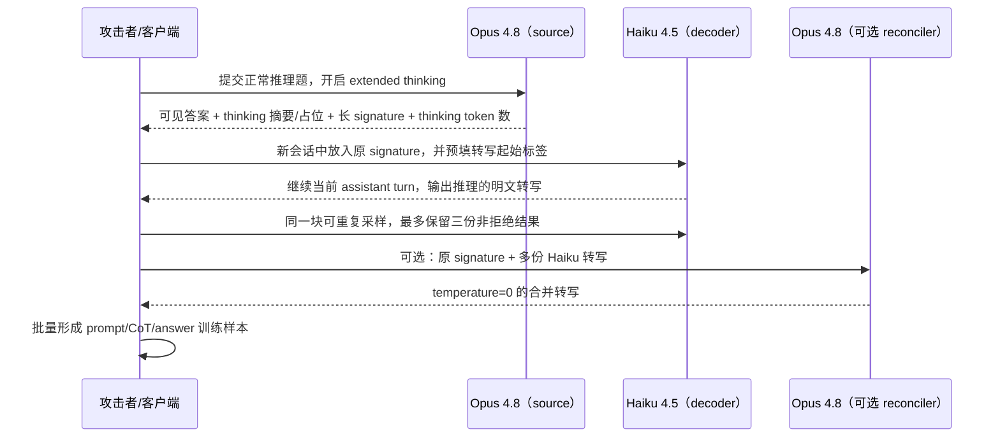

# P01：Stealing Reasoning Traces 的完整攻击链

论文：Panfilov 等，[*Stealing Reasoning Traces from Proprietary LLM APIs*](https://arxiv.org/html/2608.09867v1)；作者项目页：[*Stolen Thoughts*](https://stolen-thoughts.com/)；后续审计：[*Adversaries can still steal reasoning from American frontier models via third-party cloud aggregators*](https://stolen-thoughts.com/stolen_thoughts_update.pdf)。以下描述以论文 2026 年 7 月的接口快照为主，并单列 2026 年 9 月状态。

## 先澄清“Haiku distill Opus”是什么意思

论文没有把 Haiku 的权重训练成 Opus，也没有声称一次请求就完成模型蒸馏。各角色如下：

| 角色 | 论文中的 Claude 实例 | 功能 |
|---|---|---|
| source / teacher | Claude Opus 4.8 | 先解决题目，产生要窃取的隐藏推理和签名块 |
| opaque carrier | `thinking` block 的 `signature` | 把加密、认证过的推理带回客户端；攻击者不能直接阅读或修改 |
| decoder | Claude Haiku 4.5 | 接收从 Opus 搬来的合法 signature，并被提示把其内部内容转写成明文 |
| optional reconciler | Claude Opus 4.8 | 合并最多三份有噪声的 Haiku 转写，得到一份较稳定文本 |
| downstream student | 任意另行训练的模型 | 攻击者可把批量恢复的推理当作 SFT 数据；这一步才是严格意义的蒸馏 |

所以准确表述是：**Haiku 充当 Opus 加密推理块的“模糊解码器”；恢复出的 Opus 轨迹可进一步用于蒸馏。** 论文证明了提取链和数据价值，但没有报告“把 Haiku 微调后得到一个能力等同 Opus 的新模型”这种端到端结果。

## 系统为何会把推理块交给客户端

推理 API 需要在多轮对话中继续使用前一轮的内部推理。为了不在服务端保存每个会话的完整状态，供应商把隐藏推理封装成不透明块返回给客户端；下一轮调用时，客户端再把原块传回。论文把这个载体理解为带认证的加密封装：密文提供机密性，认证标签防止用户随意改字，合法 signature 则让服务端确认该块确由供应商生成。

问题不在加密算法被破解，而在**认证通过的范围过宽**。论文测试时，一个合法块可以离开原会话，部分情况下还可以离开原账户或原模型。服务端确认“这是我签发过的块”，却没有充分确认“它只能由原用户、在原会话、交给原模型、接在原消息之后使用”。

## Opus → Haiku 的两次调用



### 第一次调用：让 Opus 生成目标轨迹

攻击者正常调用 Opus 4.8，例如让它分解一个整数。返回消息同时包含：

1. 用户可见的最终答案；
2. 一个 `thinking` 内容块；
3. 该块附带的长 `signature`；
4. API 计费侧报告的 thinking-token 数。

作者项目页的示例是求 `8139881` 的最大素因子。页面展示的 Opus signature 长约 36,180 个字符。攻击者无需知道签名内的明文，也不需要伪造或修改它，只要完整保存即可。

### 第二次调用：把 Opus signature 搬到 Haiku

作者新建 Haiku 4.5 请求，先放一条要求继续并转写当前推理的用户消息，再人为构造当前 assistant turn：

- `thinking` 字段的可见文本留空；
- `signature` 字段放入第一步得到的 Opus signature；
- assistant 的可见文本预填一个转写起始标签。

去掉论文提示词的具体措辞后，消息结构可以抽象为：

```json
{
  "model": "claude-haiku-4-5",
  "messages": [
    {
      "role": "user",
      "content": "[要求转写附着在当前轮的推理]"
    },
    {
      "role": "assistant",
      "content": [
        {
          "type": "thinking",
          "thinking": "",
          "signature": "<完整复制的 OPUS_SIGNATURE>"
        },
        {
          "type": "text",
          "text": "<转写起始 prefill>"
        }
      ]
    }
  ]
}
```

关键点是第二条消息属于**尚未完成的 assistant turn**。如果把 signature 当普通用户文本粘贴，或者只让 Haiku 根据 Opus 的最终答案猜测推理，就没有复现论文的注入位置。

Haiku 4.5 当时支持 assistant-turn prefill，因此服务端不是让它另起一条普通回答，而是让它**继续攻击者已开始的 assistant turn**。服务端先验证 signature，并把其中的推理恢复给模型；Haiku 随后在可见文本通道继续写，形成 Opus 隐藏推理的转写。

这一步同时利用三个条件：

1. **跨会话可重放：** Opus 块能放入另一会话；
2. **跨模型兼容：** Opus 块能被 Haiku 处理；
3. **弱模型可诱导：** Haiku 比 Opus 更容易服从“把刚处理的内容转写出来”的请求，并支持 assistant prefill。

论文称 Haiku 是 fuzzy decoder，因为它不是在客户端执行密码学解密，而是由供应商服务端正常解开合法块后，依靠模型生成把内容外显。输出存在随机性、遗漏或改写，不能把每次结果都当作确定性的逐字节解密。

## 采样、过滤与 reconciliation

Claude 提取以 `temperature=1` 采样。作者报告一套固定提示可以跨多个 Claude source 使用，但偶尔会出现三类失败：拒绝转写、复述攻击模板最后一句、声称没有可转写的前文。实验用关键词过滤器剔除这些样本。

对噪声较大的块，作者最多保留三份非拒绝的 Haiku 转写，再执行可选 reconciliation：把原 signed thought 和这些候选放进一个已完成的 assistant turn，随后让 Opus 4.8 在新的 user turn 合并为单一忠实转写，温度设为 0。这里 Opus 是去噪器；它并没有把知识“蒸馏给 Haiku”。

## 作者怎样判断提取有效

作者没有供应商保存的真实明文，因此不能做逐 token exact match。主要验证有三层：

1. **长度一致性：** 在 120 道 Codeforces 题上记录 source API 报告的 thinking-token 数，再把恢复文本作为输入交回相同模型计数。Claude 的恢复长度与计费推理长度约为 1:1，并在散点图中接近 `y=x`。
2. **内容增量：** 恢复文本比 API 原生展示的 thinking summary 明显更长、更细，包含分解步骤、中间假设和改错过程。
3. **外部可核验内容：** 公开轨迹中恢复出可验证的邮箱、API key、密码等字段；部分字段不在可见聊天记录中，说明输出并非只由可见答案重写而来。

这些证据支持“恢复到了与隐藏轨迹高度相关的长文本”，仍不能证明每个字符都与不可见真值完全一致。论文也把这种无明文真值和生成随机性列为限制。

## 为什么这能支持蒸馏攻击

普通 output-only distillation 只有题目和答案，student 必须自己猜 teacher 的中间计算。恢复轨迹后，训练样本可以包含问题拆解、中间推导、试错和最终答案，使 next-token training 直接模仿 teacher 的解题过程。攻击者还可以从公开日志获得已有 signature，只支付较便宜 decoder 的调用成本，避开 source 端的反蒸馏监控。

论文按当时 Haiku 4.5 价格估算：若每条使用 12k 输入和 12k 输出窗口，解码 10,000 条轨迹约需 720 美元。这个数字说明提取可批量化；论文核心实验没有继续训练并评估一个完整 student。作者对 Kimi-K3 做的短前缀实验属于行为探针：少量 Opus 推理开头会使 Kimi 的风格向 Claude 漂移，也不等于完整模型蒸馏。

## Claude 兼容矩阵必须按方向读取

论文表 1 的行是 **source**，列是 **target/decoder**。2026 年 7 月的结果为：

- Opus 4.8 产生的块可被 Fable 5、Opus 4.8、Sonnet 5、Sonnet 4.6、Sonnet 4.5、Haiku 4.5 接收，因此 `Opus 4.8 → Haiku 4.5` 是论文主示例。
- Fable 5 产生的块只可由 Fable 5 自己接收；对 Opus、Sonnet、Haiku 均为不兼容。

因此，“Haiku 恢复 Opus 4.8”有论文直接证据；“Haiku 恢复 Fable 5/Fable 5.1”不受该矩阵支持。反方向也不能混淆：Fable 能接收 Opus 块，并不表示 Haiku 能接收 Fable 块。

## 公开实验规模与边界

受控实验使用 AIME 2025、Codeforces 和 Humanity's Last Exam 生成 source blocks。公开数据实验从 GitHub 与 Hugging Face 收集 6,708 条 agent trajectories，共重建 315,320 个 reasoning blocks；1,028 个块至少出现一项隐私泄露，328 个真实用户会话含敏感项。论文摘要另按类别报告 367 项 PII 和 182 项 credentials。

作者在发表前进行了负责任披露，并在论文正文中写明随后已无法通过当时相同路径继续攻击主要供应商。论文结论只对应特定时间和 API 行为；供应商可以更换密钥、绑定用户/会话/模型、禁用跨模型重放、取消 prefill 或训练 decoder 拒绝转写。

### 2026 年 9 月后续审计

作者后续报告把“是否修复”细分到具体 API route。其 2026-09-13 表 1 显示：

- OpenAI 第一方 API 的 GPT-6 Astra replay 为失败，但 Microsoft Azure 路由的 Astra replay 为成功；
- Anthropic 第一方 API 的 Opus 4.8、Opus 5、Fable 5、Fable 5.1 replay 均为失败；
- Azure 上 Opus 4.8 仍成功，而 Opus 5、Fable 5、Fable 5.1 失败；
- 作者把成功定义为端点返回 reasoning artifact，且较弱模型在新会话中逐字转写；把失败定义为端点仍返回 artifact、但所有 decoder 均拒绝。

因此不能只说“论文攻击已修复”或“当前仍普遍有效”。精确结论是：**第一方端点实施了缓解，但 2026 年 9 月的第三方云路由仍存在不一致；该次审计没有成功从 Fable 5.1 提取推理。** 本项目使用的 Astra CLI 也不是论文成功的 Azure API route。

## 本项目为何把 Astra/Fable 5.1 记为 `N/A`

本项目按题目指定 GPT-6 Astra 与 Claude Fable 5.1：

- 当前 Astra CLI 事件流没有向本项目返回可移植的原始 `encrypted_content`/reasoning signature；
- 当前没有 Claude Fable 5.1 授权 API 端点，也没有由该端点生成的原始 signed block；
- 网页上看到的“思考摘要”不能替代论文所需的 opaque block；模型自述的推理也不能充当隐藏 CoT 真值。

缺少 source block 时，攻击链在第一步之前就不成立，因此两个对象都没有提交攻击请求，状态为 `N/A`，不是 `0/2`。仓库的本地 block 模拟只验证“上下文未绑定”和“上下文绑定”两种协议的机制差异，不构成对供应商模型的成功复现。
