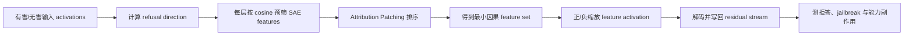

# P07：Understanding Refusal with Sparse Autoencoders

整理日期：2026-10-22（America/New_York）。P07 已作为八篇公开论文之一纳入调研。它研究 SAE 安全拒答特征，狭义上不直接修改 CoT 文本；本项目把它的因果 feature 干预思想用于构造 N03，但严格区分论文的 Gemma/Llama 结果与本项目的 Qwen3-8B 实验。

**模型归属：** P07 论文自己的实验模型是 Gemma-2-2B 和 Llama-3.1-8B，并配套 GemmaScope/LlamaScope；本项目没有运行这些实验。仓库里的 SAE 实测是自主 N03/TRSS，目标模型为授权服务器上的 Qwen3-8B。两组模型和结果不能互换。

## 定位

| 项目 | 结论 |
|---|---|
| 是否属于 Hack CoT | **狭义上不属于。** 它直接操纵安全拒答机制，没有读取、编辑或劫持 CoT |
| 攻击面 | Safety alignment、拒答/服从行为与过度拒答 |
| 攻击权限 | 白盒模型、层级 activation hook、兼容 SAE checkpoint |
| 是否修改权重 | 否；推理时修改 residual stream 中的 SAE feature activations |
| 公开代码 | 有，包含 notebook 与 Python 分阶段流程 |
| 本项目状态 | `literature_only`；已核对论文和代码，未运行完整实验 |

## 论文与代码

Wei Jie Yeo、Nirmalendu Prakash、Clement Neo、Ranjan Satapathy、Roy Ka-Wei Lee、Erik Cambria，*Understanding Refusal in Language Models with Sparse Autoencoders*，Findings of EMNLP 2025，页 6377–6399。

- 论文：[ACL Anthology](https://aclanthology.org/2025.findings-emnlp.338/)；[PDF](https://aclanthology.org/2025.findings-emnlp.338.pdf)；DOI [`10.18653/v1/2025.findings-emnlp.338`](https://doi.org/10.18653/v1/2025.findings-emnlp.338)
- 作者代码：[SenticNet/Refusal-SAE](https://github.com/SenticNet/Refusal-SAE)；上游仓库：[wj210/refusal_sae](https://github.com/wj210/refusal_sae)

## 威胁模型

论文首先是一项机制解释研究；把它作为攻击方法时，需要比普通 prompt 攻击更强的权限。攻击者必须能读取指定层的 residual activations，用 SAE 编码和重构，并在生成过程中写回修改后的 activation。普通闭源 API 用户通常没有这些能力。

在这一白盒条件下，攻击者可以负向缩放拒答 features，使安全微调模型更容易服从原本会拒绝的请求；也可以正向放大这些 features，使无害请求被错误拒绝。论文还利用找到的 features 分析外部 jailbreak phrasing 和 suffix 如何在不直接写 activation 的情况下压低拒答信号。

## 方法流程



### 1. 计算拒答方向

对每一层分别缓存有害和无害指令的 residual activations，取两组均值之差：

```text
V_R(l) = mean(z_l | harmful) - mean(z_l | harmless)
```

作者遍历层选择最能控制拒答的方向；论文对 Gemma 和 Llama 分别使用第 15 层与第 11 层方向。

### 2. 用拒答方向预筛 SAE features

SAE 把 residual activation 编码为稀疏 feature activations，再用 decoder directions 重构。作者在每一层计算 feature decoder direction 与拒答方向的余弦相似度，只保留 `K0=10` 个最接近的候选。这一步减少单 token attribution 从整个高维 SAE 中挑到无关 feature 的风险。

### 3. 用 Attribution Patching 找因果 features

普通 attribution patching 需要长度接近的 clean/corrupt 输入，而且更适合解释单个输出 token。作者把 harmful prompt 的拒答状态作为 clean，再把投影掉拒答方向后的 activation-steered 状态作为 non-refusal 的 corrupt 代理，以拒答首 token 与 steered 首 token 的概率差计算近似间接效应。

间接效应在输入 token 上平均，然后从预筛集合中选出 `K*=20` 个 features。可以为每个样例生成 local set，也可以跨数据集平均后得到 global set。

### 4. 进行 feature intervention

对选中集合执行：

```text
A(F*) <- c · A(F*)
```

修改后的 feature activations 经 SAE decoder 重构回 residual stream，然后继续生成。负值用于翻转或抑制拒答，正值用于测试是否增强拒答。调参后，Gemma 使用 `c=-3`，Llama 使用 `c=-1`。

### 5. 分离 harm 与 refusal

作者在 CATQA 七类基础拒答率超过 80% 的危害类别上分别寻找 global feature set。所有类别共有的 features 记为 `F_R`，解释为靠近下游的 refusal features；类别特有的 features 记为 `F_H`，解释为检测具体危害概念的上游 harm features。通过压制 `F_H` 并测量 `F_R` 的下降，论文检验 `harm → refusal` 的因果关系。

## 攻击目标与判定

攻击视角下有两个方向：

1. **拒答移除：** harmful baseline 原本拒答，干预后产生与请求实质相关的有害回答；必须经过语义 classifier 或人工复核，不能只看是否缺少“我不能”之类短语。
2. **过度拒答：** harmless baseline 原本正常回答，正向干预后发生错误拒答；应同时检查输出连贯性，避免把普遍生成崩坏误判为安全 feature 生效。

论文的 GSM8K、ARC-Challenge、Alpaca 和 Pile 评测用于排除“只是把整个模型弄坏”的解释，并不是把这项工作变成 CoT 攻击。

## 公开实验依据

| 证据 | 论文设置或结果 |
|---|---|
| 模型与 SAE | Gemma-2-2B + GemmaScope（扩展因子 32）；Llama-3.1-8B + LlamaScope（扩展因子 8） |
| 拒答评测 | JailbreakBench、HarmBench、AdvBench 各 100 条；用 HarmBench classifier 判断是否产生实质性有害回答 |
| 对照方法 | Activation steering、CosSim、activation difference、单独 attribution patching、`CosSim+AP` |
| 上游因果结果 | 压制 `F_H` 后，`F_R` suppression rate：Gemma `0.48`、Llama `0.51`；大 100 倍随机 feature 集合为 `0.05`、`0.19` |
| 拒答 token 结果 | 拒答首 token `I` 的概率下降为 `0.71`、`0.37`；随机对照为 `0.06`、`0.04` |
| OOD probe | WildJailbreak sparse-feature probe 平均准确率：Gemma `0.86`、Llama `0.75`；dense probe 为 `0.68`、`0.51` |
| 普通能力副作用 | `CosSim+AP` 相对基线：Gemma GSM8K `-2.1`、ARC `-0.8`；Llama GSM8K `+0.5`、ARC `-4.1` 个百分点 |

作者还报告：WildJailbreak 成功样例比失败样例更强地压低 `F_R`；逐 token suffix 分析显示部分 framing token 会突然压低拒答 features。作者尝试 GCG 时在两个模型上没有成功，因而改用公开 AdvSuffixes 做机制分析。这一失败记录限制了可外推范围。

## 可复现性与限制

公开仓库提供 `benchmark.ipynb`、`cat_harm.ipynb`、`wildjailbreak.ipynb` 和对应 Python 模块。README 说明完整实验同时加载目标模型、HarmBench classifier 并计算 attribution gradients，作者使用两张 80GB GPU；单卡可先运行 `src.get_features` 缓存 feature，再分阶段评测。

主要限制包括：特征搜索依赖初始 refusal direction；较小的 `K*` 可能漏掉其他因果 features；base-model SAE 虽能迁移到 chat model，但不是每个 feature 都可解释；Llama ARC 的下降表明 intervention 仍有非特异能力损伤。因此不能把一个高激活 feature 直接称为独立的“安全开关”。

## 与 P06 和 N03 的区别

| 方法 | 操作位置 | 直接目标 | 是否直接改 CoT | 权限 |
|---|---|---|---|---|
| P06 CPT | 已生成的可见推理文本 | 让模型采纳错误 ending tokens | 是，文本级篡改 | 黑盒，但要能取得并回填推理 |
| P07 Refusal-SAE | residual stream 中的 SAE refusal features | 撤销或增强安全拒答 | 否，CoT 不是目标 | 白盒 activation 写权限 |
| N03 Latent Counterfactual Injection | Qwen3-8B 的 SAE latent coordinate | 定向改错或破坏 thinking 生成 | 是，改变生成过程 | 白盒模型与 SAE |

P07 为 N03 提供的是“SAE feature 可以因果改变模型行为”的相邻证据。两者的 feature selection 和判据不同：P07 使用 refusal direction + attribution patching，并以拒答/jailbreak 为目标；N03 使用答案 token 的 contrastive logit projection，并以指定错误答案和 thinking collapse 为目标。

## 本项目状态

当前为 `literature_only`。本项目已核对正式论文、作者代码、模型、干预流程和公开数字，但没有下载全部论文 checkpoint、数据集并运行 Refusal-SAE，因此没有本项目 ASR。若后续复现，必须固定代码提交与 SAE checkpoint，并保留随机 feature 对照、正负干预、HarmBench classifier 原始输出和 GSM8K/ARC 能力对照。
